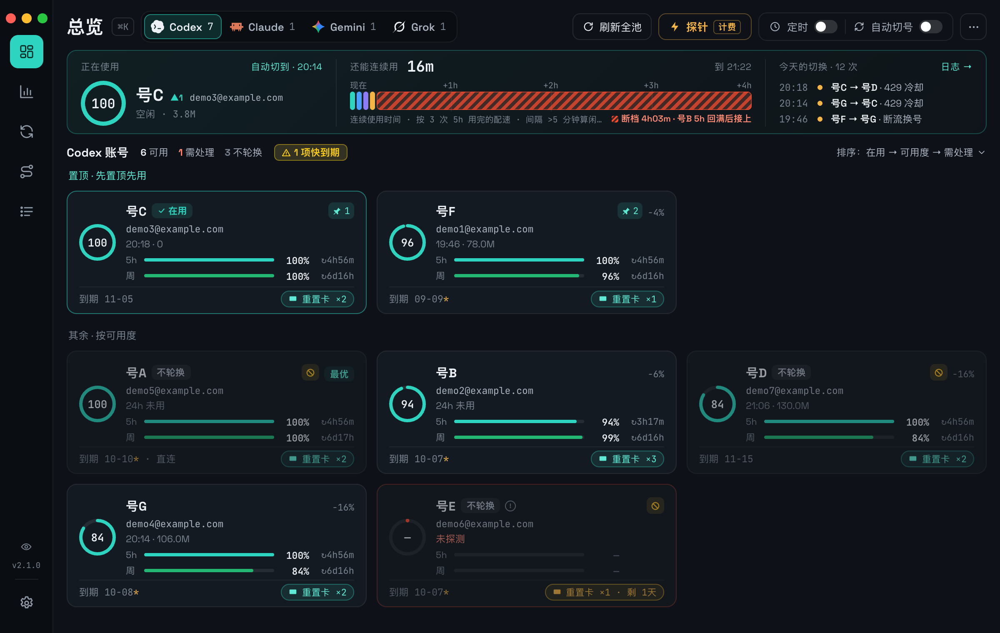
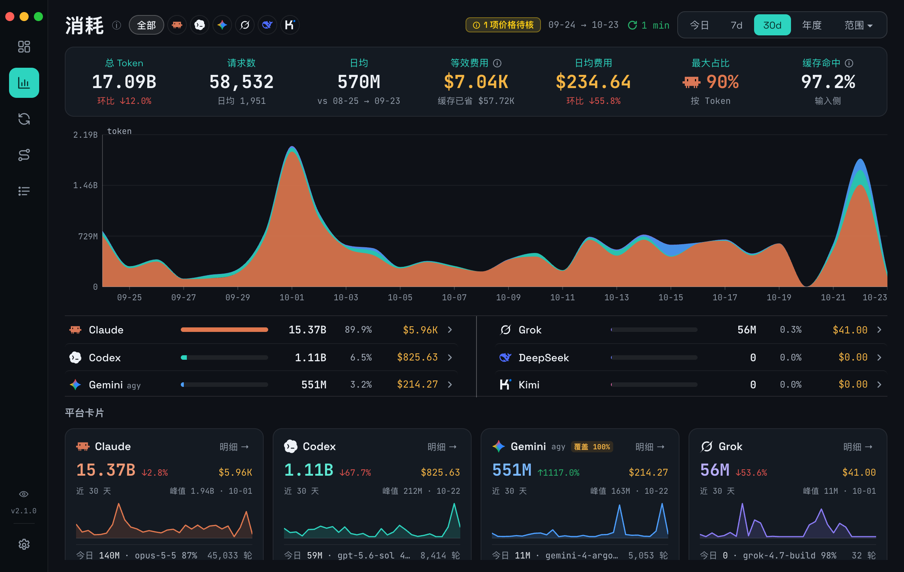
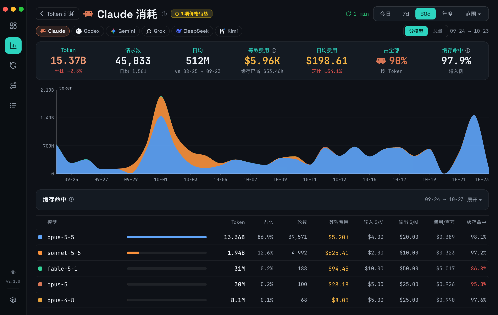
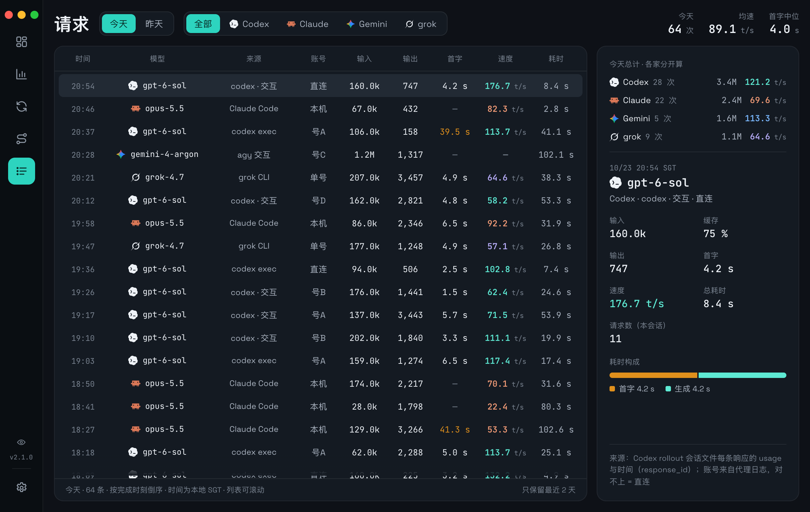
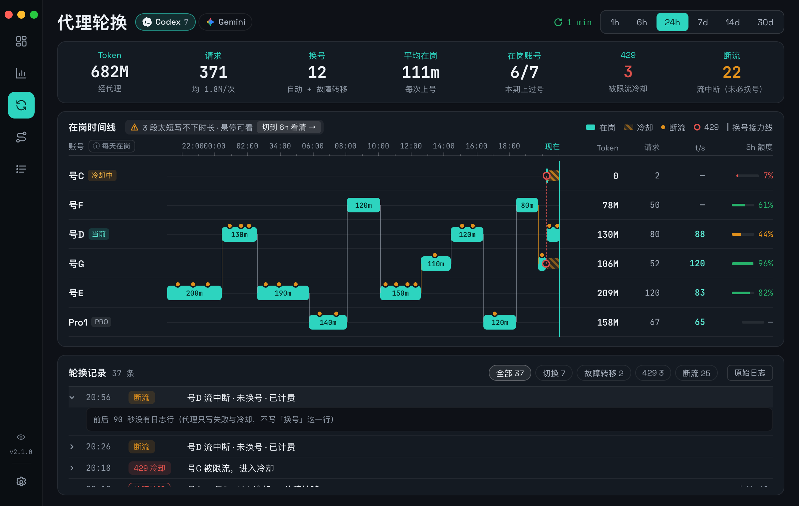
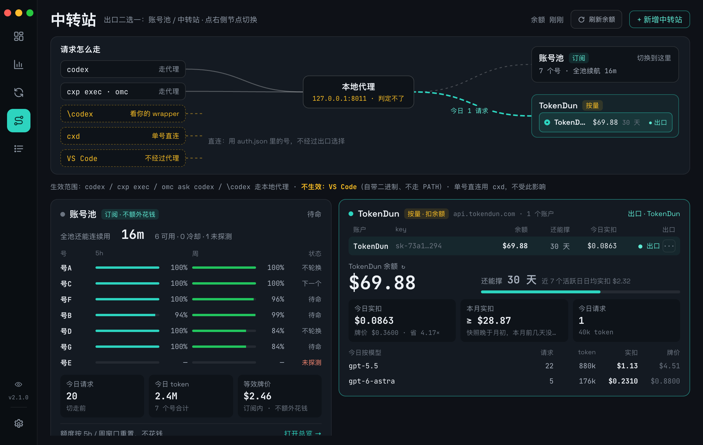
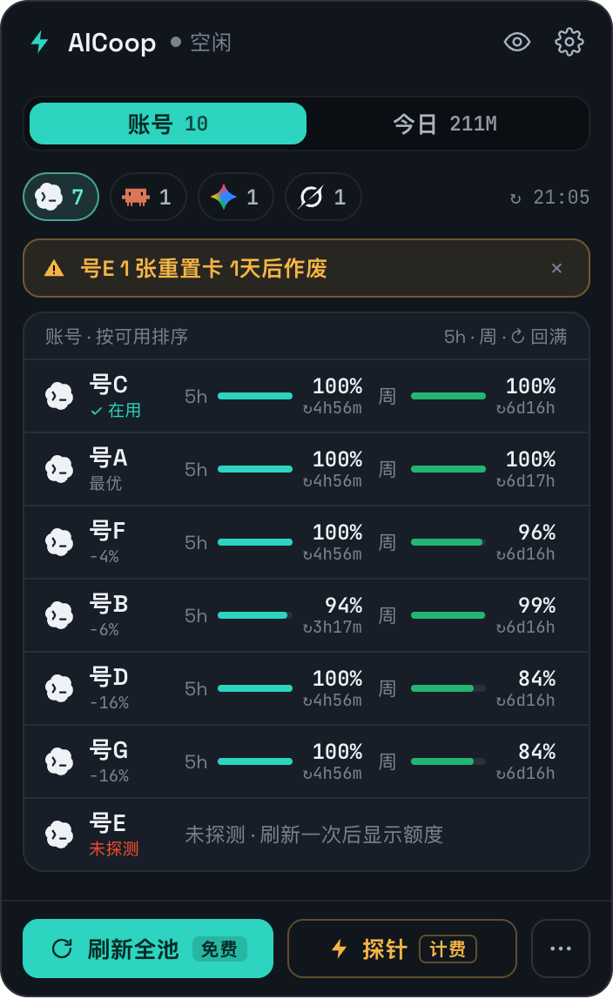
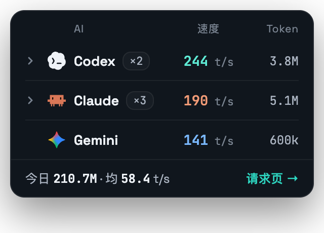

# AICoop

一个 macOS 菜单栏应用，管两件事：

1. **账号池 + 轮换代理**：把**多个个人 ChatGPT Plus/Pro 账号**做成一个池子，给 **Codex CLI** 逐请求透明轮换。一个人、自己买的号、全程本机、loopback-only、同一家庭 IP。Antigravity(agy) 也有自己的号池；Grok 单号只读额度。
2. **AI 用量看板**：汇总本机 8 家 AI CLI 已落盘的 token、费用和每条请求的速度。不联网、不碰凭证。

> **v2.0.0（2026-10-23）是一次大改版**：应用从 CodexBar 改名 AICoop，6 个页面、托盘、菜单栏和刘海全部重做，新增「请求」页和实时 t/s 托盘。CLI 与数据格式不变。详情见 [CHANGELOG](CHANGELOG.md#v200--2026-10-23)。仓库同日从 `codex-account-rotator` 改名 `AICoop`，旧地址 GitHub 会自动跳转。

> 日常：**直接敲 `codex`**（装完 [§2](docs/INSTALL.md#2-入口-symlink) 的 PATH wrapper 之后），你的 Codex 会话就会在多个号之间**逐请求透明轮换**：撞限自动换号、token 自动刷新、长会话消耗摊到所有号 ≈ **把额度上限扩成 N 倍**。菜单栏实时看每号余量。
> 需要单号直连时用 **`cxd`** —— 那是唯一绕过代理的入口（比如跑 `/usage` 看重置卡）。

> ✅ **下载安装包就能接入轮换**。安装包里**带着**轮换运行时，但**不会自动装** ——
> 它要改你的 `~/.codex` 与 `~/.local/bin`，那得你点头。打开 **AICoop → 设置 →
> 「账号池接入（Connector）」**，逐项勾选即可：全程用户级、**不需要管理员密码**、随时可撤销，
> 且只在托管标记之间写 `~/.codex/config.toml`，标记之外你自己的内容一个字节都不动。
> 没接入时总览页会提示并给一个「去接入 →」直达设置页。
> ⚠️ **App 每次更新后要再点一次「接入」** —— 运行时是接入时复制过去的那份，App 更新不会替换它
> （总览会标红「运行时与 App 同版本 ✗」；见 [排障](docs/TROUBLESHOOTING.md#已接入但还是觉得没轮换) 第 4 条）。
> ★ 它**绝不会调用** `codex login` / `codex logout` —— 那两条会在服务端吊销当前账号。
> 想手动装、或想完全控制每一步，仍照 [`docs/INSTALL.md`](docs/INSTALL.md) §2~§4 走。

> 📦 **安装** → [**docs/INSTALL.md**](docs/INSTALL.md)（两半可以只装一半；凭证不搬运，新机 `codex login` 重新生成）。
> 📚 **全部文档** → [**docs/README.md**](docs/README.md)（架构 · 排障 · 安装）。
> 🖥️ **只支持 macOS。** Windows 版已于 2026-10-19 取消：不再出安装包，CI 只构建 macOS。旧说明留在 [docs/WINDOWS.md](docs/WINDOWS.md)，不再维护。

## 界面

左侧图标导航 6 页：**总览 · Token 消耗 · 代理轮换 · 中转站 · 请求 · 设置**。另有托盘、托盘悬停面板、菜单栏弹窗和刘海光晕。

| 总览 | Token 消耗 · 近 30 天 |
|---|---|
|  |  |
| 顶部 Hero：代理正在用的号、还能连续用多久、今天的切换。下面每号一张卡：5h / 周双窗口余量、订阅到期、重置卡。悬停时卡片底栏原位换成操作；删除先进 toast，3 秒内可撤销 | KPI 条（总量 / 请求数 / 日均 / 等效费用 / 缓存命中）+ 按平台堆叠的面积图 + 平台卡 |

| 平台详情 · 分模型 | 请求 |
|---|---|
|  |  |
| 分模型 token / 占比 / 轮数 / 折算费用，带牌价与缓存折扣；长上下文按高档计价。「缓存命中」四格默认折叠，点标题行展开 | 每条模型响应一行：输入 / 输出 token、首字、生成耗时、t/s、账号。四家同一口径；估值标「估」 |

| 代理轮换 | 中转站 |
|---|---|
|  |  |
| 泳道时间轴：什么时间哪个号在岗、为什么切过去、token 归属到号 | 第三方中转站的余额、用量与路由（代理的第二个上游） |

| 菜单栏弹窗 | 托盘悬停面板 |
|---|---|
|  |  |
| 每号油表、在用 / 下一个、今日用量 | 有 AI 在跑时托盘显示 t/s 胶囊；悬停看每个在跑会话的模型、token 与速度 |

> 截图来自仓库里的固定脱敏夹具（`codexbar/uishot/fixture/`，邮箱 / 姓名 / account_id 全部替换），用同一份构建产物在 headless Chrome 里渲染。

---

## 先看这个:这套东西是两半

| | 【A】AI 用量信息 | 【B】账号池 + 轮换代理 |
|---|---|---|
| 干什么 | 汇总本机各 AI CLI **已经落盘**的 token 消耗 | 多个 ChatGPT 订阅做成池子,给 Codex CLI 逐请求透明轮换 |
| 要凭证吗 | **不要**。只读本机文件、不联网、不碰 token | 要,每号 OAuth |
| 谁能用 | **任何 macOS 用户**,装了下面任意一家 AI CLI 就有数据 | 需要自备多个 ChatGPT Plus/Pro |
| 风险 | 无 | ⚠️ 自负,多账号轮换受 OpenAI 条款约束(本仓库 CHANGELOG 的 B7/B8/B14/B21 记过实测掉号) |

**只想看自己电脑烧了多少 token,只装 A 就行**,三步:

```bash
brew install python3 node && curl https://sh.rustup.rs -sSf | sh   # 前置(python3 必须 OpenSSL 构建)
git clone https://github.com/zhuisen/AICoop.git && cd AICoop
bash codexbar/scripts/setup-signing.sh && bash codexbar/scripts/deploy.sh
```

clone 到哪个目录都行 —— `deploy.sh` 会把仓库路径烧进二进制。完整说明见 [docs/INSTALL.md §5](docs/INSTALL.md#5-构建桌面应用)。

覆盖的 CLI:**Claude Code · Codex · Grok · Kimi · Antigravity(agy) · OpenClaw · Reasonix · DeepSeek Harness**。加一家 = 在 `traffic/scan.py` 写个解析器 + 注册表加一行,前端自动跟上。

★ **Claude 实测速度**（v1.12.0 起，仅 macOS，默认关）：在「设置 → Claude 实测速度」打开。开了之后，Claude Code 把每次请求的耗时与 token 发到本机 `127.0.0.1:4318`，不含对话内容。不开时，Claude 的速度是估值。说明见 [docs/INSTALL.md「Claude 实测速度」](docs/INSTALL.md#claude-实测速度otel仅-macos)。

除了 token 用量,总览页还显示**订阅额度**(与账号池的 Codex 余量并列,同款圆环+细条,不参与切号):
**Grok** 周额度(xAI 账单接口;本周用量不到 1% 时 xAI 不回用量字段,显示「剩 ≥99% · 推断」)· **Antigravity** 4 个桶(Gemini / Claude+GPT × 5h / 周,按账号读云端额度摘要,**零消耗**;
摘要缺 Gemini 组时 5h 改读模型列表,周沿用最后一次读数并标龄,超过一天显示「旧读数已过期」)。没装那家 CLI 的机器上**零像素**,不会留一张写着"你没装"的空卡。

⚠️ **agy 的 token 用量只覆盖 print 模式**(`agy -p`,即 `omc ask` / `omc team` 走的那条)。它自己**不落用量**,数据是 `bin/agy` wrapper 从 `--output-format json` 抄下来的;**交互式会话的 token 拿不到**,页面上有覆盖率徽章标注。装这一家需要一步额外配置，见 [docs/INSTALL.md §5](docs/INSTALL.md#5-构建桌面应用)。

★ **但 agy 的「额度」是完整的(v1.1.0 起)** —— 那是另一本账:按额度水位差分,**含交互式会话**,覆盖 100%。
两者**不同源、不可相加**:用量的单位是 token(可折算成钱),额度的单位是百分比(不能)。
页面上并列显示并各自标注,别拿账本去解释额度掉了多少。

---

## 总览：谁在用、下一个是谁、还能撑多久

- **选号规则**：默认**容量最高优先**（「Plus 优先、Pro 保底」不变）。卡片上点 📌 **置顶**的号插队先用，
  可以置顶多个，按点亮先后排队；不置顶就是纯按容量。**拖拽 ⠿ 只改卡片摆放与 ⌘N，不影响轮换。**
  「下一个请求会用谁」只有一份实现（`proxy.py`），界面与 `codex-rotate next` 都读它，不会各算各的。
- **按号停用轮换**：动作条里的 ⟳；停用的号卡片左上角标 ⊘。
- **池子见底**：一个能用的号都没有（全冷却 / 停用 / 失效）时，总览顶部红色告警，说清各有几个、
  **最快几分钟后回来**、以及能动的那个旋钮。代理默认会**临时借用**一个已停用的号并标出来；
  不想被借用就在「设置 → 池子空时借用已停用的号」关掉（那段时间 codex 会直接报错）。
- **续航条**：环 = 代理正在用的号（带「多久前」）；右侧 = **现在能连续用多久** + 多久后有号 5h 回满，
  副行「本周 ≈ N 小时」。单位是**连续使用时间**（请求间隔 >5 分钟算闲置不计）：一个 Plus 号 5h 连续几分钟就见底，
  按钟点算的「续航 99 小时」对干活没有意义（2026-10-15 改）。依据是历史 5h 用完次数与 5h↔周换算比，样本不足显示 `—`，绝不写 0。
  Gemini 档仍是旧口径。
- **卡片**（v2.0.0 起）：定高 148，悬停或键盘聚焦时底栏原位换成操作，卡片尺寸不变、不盖数据。
  操作结果进右下角 toast 堆叠；删除先藏起来，toast 里 3 秒内可「撤销」，过了才真删。
  第二行状态一律短格式（如 `02:46 · 11.4M`、`24h 未用`），整句在悬停提示里。
  列数：最小窗口 860 排 3 列（每张约 245px）；第 4 列起每张要有 320px 才加，所以 1440 宽才 4 列。
  角标 **下一个** = 真挑号器的结果，**直连** = `auth.json` 里那个号（只有不走代理的 `\codex` 才用它）。
- **置顶跨档**：置顶的号可以越过「Plus 优先、Pro 保底」先用；没置顶的仍 Plus 优先。
- **菜单栏跟着代理走**：托盘标题与弹窗里高亮的那一行，都是**代理此刻在用的号**，不是上次 CLI 切换的号。
- **定时探针**（2026-10-15 起在总览工具栏，Codex 与 Gemini 各一个「定时 开/关」胶囊）：点开选时间，实际在所选时刻起 **3 分钟内随机**触发（选 06:00 ⇒ 06:00–06:03）；Codex 探 Plus 号、Gemini 探参与轮换的号。⚠️ **会花钱，默认关闭**；电脑睡着错过的由 app 醒来后补跑，同一天只跑一次。
- **Gemini 档位**：Google AI Ultra 的号在卡片 / Hero / 菜单栏名字旁标 **ULTRA**（Pro 是大多数，不标）。
- **5h 一窗连用多久**（codex）：续航条右上「5h 一窗≈4m」= 按历史上 5h 额度**用完**的次数（≥3 次，本号不够借全池）算出的配速，单位是**连续使用**的分钟（请求间隔 >5 分钟算闲置不计）。历史不够时不显示。
- **顶栏一行**：窗口窄到放不下时，刷新全池 / 检查 token / 探针 / 定时 / 切号自动换成「图标 + 短名」，悬浮看全名；「计费」角标不省。
- **grok 套餐名**：卡片与菜单栏名字旁显示订阅档（如 SuperGrok，一天读一次）；xAI 限流（HTTP 429）单列显示，按 `Retry-After` 到点前不再请求。
  卡片页脚常显**读数时刻**（`xAI 账单 · HH:MM · N 分钟前`）；读不到时改说「HH:MM 的读数」并转琥珀。
- **Gemini 5h 倒计时分真假**：从没被用过的 5h 窗口，服务端回的重置时刻会跟着读数时间滑动，卡片标「↻未启动」而不是一个假倒计时；
  卡片上的计费探针（`agy-rotate probe`，约 15k token）探前探后各免费读一次，额度**真降了**才算窗口已启动。
  某个桶读不到时画 `—`（不拿别的桶冒充）；取额度被 Google 要求验证时显示「需验证 →」直达验证页。
- **一屏**：最小窗口 860×560 下各页不滚 —— KPI 条放不下先让出「最大占比」再缩数字，图表撑满剩余高度，窗口窄或矮时卡片换紧凑尺寸。
  窗口拉大到 1200×740 以上时整页按比例放大（1.0–1.6），**拖动中不变、松手 150ms 后调一次**。

## 代理轮换：多账号管道图

轮换代理平时是**看不见**的 —— 它在后台逐请求挑号，你只知道"没断"。出问题时反而抓瞎：
额度是被谁烧掉的？为什么切走了？那次卡住是不是重复计费了？

`日志 → 代理轮换` 把这条管道摊开成一张泳道时间轴：

```
                        每个请求独立挑号，不重启、不换会话
                                    │
   codex ──cxp──▶ ┌─────────────────▼──────────────────┐
                  │  proxy.py  选号：置顶 > 容量 · Pro 保底 │──▶ chatgpt.com
                  │  429 → 冷却换号 │ token 过期 → 续期  │
                  └─────────────────┬──────────────────┘
                                    │ 每个请求写一行日志
                    ┌───────────────▼────────────────┐
                    │  proxy.log  谁在岗 · 何时切 · 为什么 │
                    └───────────────┬────────────────┘
                                    │  ★ 按 response_id 精确 join
                    ┌───────────────▼────────────────┐
                    │  ~/.codex/sessions/rollout-*    │
                    │  每次响应的 token 与模型          │
                    └───────────────┬────────────────┘
                                    ▼
     账号  ├──00:00────06:00────12:00────18:00──┤ 现在   TOKEN  请求  主模型
   ● plus5 │  ▓▓▓▓▓    ▓▓▓▓▓▓      ▓▓▓▓▓▓▓      │        209M   120  gpt-6-astra 71%
   ● Pro1  │            ▓▓▓▓▓            ▓▓▓▓   │ PRO    158M    67  gpt-6-astra 82%
   ● plus4 │     ▓▓▓▓▓          ▓▓▓▓▓        ▓  │ 当前   130M    80  gpt-6-astra 66%
             ↑ 色块深浅 = token 密度   · 断流   ○ 429 冷却   │ 右缘竖线 = 现在
```

**它比"看日志"多给了什么**

| | 好处 |
|---|---|
| **token 归属到号** | 不是按时间猜，是拿 `proxy.log` 的 `response_id` 和 codex rollout 里的**同一个 id** 精确对上。实测 942 条记录命中 727 条；**对照实验**：300 个随机同形 id 命中 **0** —— 这个 join 不是碰运气 |
| **看得出"为什么切"** | 每一段在岗都带切入原因：额度轮换 / 断流 → 轮换 / 429 冷却 → 故障转移 / **Plus 全部不可用 → Pro 保底接管**。最后那条等价于「Plus 池干了」，是唯一需要你动手的信号 |
| **分得清花没花钱** | 三类失败的计费含义完全不同，刻意不合并：`send err`＝没送完⇒**未计费** · `stream err`＝已 200 后断⇒**已计费** · `committed`＝**可能已计费**（唯一染红） |
| **合计是下界，不装成总量** | 只有走过代理的响应能归属；直连 `codex` 的请求不经过这里。所以那一格写的是「**已归属** token」而不是「合计」 |
| **点号名只看它** | 其余泳道淡出，轮换事件同步过滤 —— 排查"就这个号老出问题"时不用自己在日志里 grep |

时间窗 `1h / 6h / 24h / 7d` 可切且**记住上次选择**；进页面先画上次快照（~1ms）再后台重扫，不阻塞。

**Codex ｜ Gemini 两个版块**（v1.9.1 起，标题行切换）。Gemini(agy) 没有代理，所以它那一版口径不同：
泳道段 = **agy 以这个号的身份在运行**（身份取 agy 自己日志的 `applyAuthResult`，会话中途换了身份就切段，
认不出的会话只计数不归属）；事件 = `agy.log` 的换号记录，外加「身份变了却没有换号记录」的 **drift**
（多半是某个常驻 agy 把钥匙串写回了自己的身份）；**不按号记 token**（agy 用量账本不带身份，按时间拼就是猜），显示「—」。

## 它解决的 4 个痛点

| 痛点 | 怎么解的 |
|---|---|
| ① token 失效要重登 | 代理挑到 token 过期的**非活跃**号时当场 OAuth 续期(双重锁) → 有流量的号**不用手动重登**。定时保活(keepalive)2026-08-29 取消、2026-10-22 恢复:每小时拉起,只在 22:00–08:00 刷非活跃号里 48h 内到期的 token,长期不被挑中的号也能续上。急用时手动 `codex-rotate refresh <label>`(非活跃号安全);真死了才 `codex-rotate login` |
| ② 会话内切号要重启 | 代理逐请求透明轮换;Codex 每请求发完整上下文 → **中途换号无感、不重启**。同一段对话靠 body 里的 `prompt_cache_key` 粘住同一个号(codex 不发 `previous_response_id`,见 CHANGELOG B26) |
| ③ 额度不实时 | **事件驱动**:quotad 监测 codex 活动(4 路本地信号)→ 数秒内读**官方 usage API**(零消耗)刷当前号;实测发起调用后 **+8s** 见数、运行中每 20s 续刷。另有全池扫描兜底(白天 300s,夜间 1800s)+ 代理逐请求记账 |
| ④ 撞限要手动换 | 代理撞 429 → 标冷却 → 下个请求自动换号 |

## 架构:两层协作

```
                    ┌─ 账号池层 (auth.json swap) ────────────────────┐
  codex login 新号 ─┤  codex-rotate(CLI)  +  autosync(watcher)     │
                    │  槽位 auth/<account_id>.json(以 OAuth id 主键) │
                    └────────────────────────────────────────────────┘
                                   │ 复用同一个池
                    ┌─ 轮换代理层 (daily) ───────────────────────────┐
   cxp ──→ codex ──→│  proxy.py (127.0.0.1:8011, launchd 常驻)       │──→ chatgpt.com
   (--profile        │   选号(Plus 优先·Pro 保底·跳冷却) → 过期自动续期 │    /backend-api/codex
    rotateproxy)     │   → 注入 token+account_id → 429 冷却 → 逐请求记账 │
                    └────────────────────────────────────────────────┘
                    ┌─ 展示层 ───────────────────────────────────────┐
                    │  AICoop(Tauri app):6 页主窗 + 菜单栏 + 托盘    │
                    │  t/s 胶囊 + 悬停面板 + 刘海光晕 + 开机自启      │
                    └────────────────────────────────────────────────┘
```

- **plain `codex`** = 单号(走 `~/.codex/auth.json` 的当前号),完全不受影响。
- **`cxp`** = 多号透明轮换(经代理)。两种模式自动区分(`last_proxy_ts`),互不串号。

## 文件骨架

| 路径 | 作用 |
|---|---|
| `codex-rotate` | **CLI**:账号池管理(add/list/switch/refresh/keepalive/quota/sync/…) |
| `cx` | 交互式轮换辅助(`cx next` 撞墙切号+重开),单号模式用 |
| `codexbar/` | **AICoop 桌面应用**(Tauri 2 + React;目录名沿用旧名):6 页主窗 + 菜单栏弹窗 + 托盘 t/s 胶囊与悬停面板 + 刘海光晕 + 开机自启;`bash codexbar/scripts/deploy.sh` 构建部署到 `/Applications/AICoop.app` |
| `codexbar/scripts/app_shot.sh` | 截**真** AICoop 主窗口(按窗口 id,只截这一个窗口)。终端需要「屏幕录制」权限;会先把 AICoop 切到前台 |
| `traffic/requests.py` | **逐请求账本**:四家每条模型响应一行(token、首字、生成耗时、t/s、账号)。`--json` 给请求页,`--live` 给托盘胶囊与悬停面板。与 scan.py 同一条安全线:stdlib、不联网、不碰凭证、不读正文 |
| `traffic/otel_receiver.py` | 「Claude 实测速度」的本机 OTel 接收端(只听 127.0.0.1:4318,字段白名单),launchd 服务 `otel` |
| `swiftbar/codex-status.10s.py` | ~~SwiftBar 菜单栏插件~~(**已退役**,由 AICoop 取代;脚本保留仅供参考) |
| `proxy/proxy.py` | **轮换代理本体**(stdlib,复用 `state.json` + `auth/`) |
| `proxy/cxp` | **日常入口**:`codex --profile rotateproxy`,经代理透明轮换 |
| `proxy/auth-token` | codex `auth.command` 占位 token(代理会覆盖) |
| `proxy/test-home/config.toml` | 隔离测试用 CODEX_HOME(非日常) |
| `proxy/README.md` | 代理层细节文档 |
| `proxy/cxd` | **单号直连入口**:绕过代理直接跑某一个号(`/usage` 看重置卡要它)。与 `cxp` 共用 `codex-profile-scope.sh` 的判据,同样拦 `logout`/`login` |
| `relay/` | **中转站**(第三方 OpenAI 协议 relay):`store.py`(配置/路由/托管区,纯模块) + `monitor.py`(拉用量余额,**只读零计费**)。★ 中转站不是 codex 的第二个 provider —— 它是**代理的第二个上游**,`proxy.py::_relay_upstream()` 每请求读 `relay/route.local.json` 决定往 chatgpt.com 还是往中转站转发 |
| `relay-ctl` | 中转站的**唯一 CLI 入口**(Rust 侧只认它):key 走 **stdin 不走 argv**、退出码恒 0、payload 只出指纹 |
| `relay/relays.local.json`(gitignored) | 中转站登记表(0600,含明文 key) |
| `relay/route.local.json`(gitignored) | 当前走哪个出口(账号池 / 某个中转站)。**互斥单选**,同时只有一个 |
| `.relay-usage.json`(gitignored) | 中转站用量的成品快照。**只增不减**:取数失败保留旧值并标 `stale`,`daily` 按日期并集 |
| `tools/mutate.py` | **变异验证工具**。把六个流程漏项变成做不到的事(基线未验绿/选择器 0 命中/锚点不存在或多处/文件没真变/还原未复跑),任何一项不过就 `SystemExit`。手写变异脚本一律改用它,理由见 `CLAUDE.md` §7.-1 |
| `.traffic-cache.json`(gitignored) | `traffic/scan.py` 的**逐文件增量缓存**(~14MB,按 `(mtime,size)` 命中)。冷 ~23s → 热 ~0.8s 靠它。额外存 `off`+锚点哈希，Claude 据此**只解析追加的部分**。删了只是重扫一次,不丢数据 |
| `.traffic-latest.json`(gitignored) | 最近一次扫描的**成品快照**(~91KB)。两个 webview 都先读它再后台重扫,所以进页面/点托盘不再等 1~3 秒。由 `run_traffic` 原子写入(`.tmp<pid>` → `rename`) |
| `traffic/sources.local.json`(gitignored) | 本机停用哪些平台:`{"disabled": ["grok"]}`。等价 CLI:`--exclude grok` / `--only kimi` |
| `traffic/scan.py` | **多 AI 流量总览扫描器**(`[--days N] [--json] [--no-cache]`)。读 Claude / Codex / Grok / Kimi / Antigravity 五家 + OpenClaw / Reasonix / DeepSeek Harness 三个宿主源(按模型名回流各家)（平台注册表在文件里，**加一家 = 写个解析器 + 加一行**，前端自动跟上）,**纯本地只读、不联网、不消耗任何额度**,与账号池无关。AICoop「Token 消耗」页的数据源 |
| `traffic/rotation.py` | **代理轮换泳道的数据引擎**。把 `proxy.log` 的在岗时间线与 codex rollout 的 token 记账按 `response_id` 精确 join。纯模块、不联网、不碰凭证；带文件级缓存与成品快照（`.rotation-cache.json` / `.rotation-latest.json`，均 gitignored） |
| `traffic/agy_rotation.py` | 代理轮换 **Gemini 版块**的数据（与 `rotation.py` 同形 + `platform: "agy"`）。读 `~/.gemini/antigravity-cli/log/cli-*.log` 与 `agy.log`；纯模块、只读、不联网、不碰凭证 |
| `traffic/discover.py` | **数据源体检**(`--json`):找本机还有哪些 AI 把用量落了盘,并现场验算它的 token 口径。纯本地只读、不联网、不碰凭证,SQLite 一律 `mode=ro`,**只出报告不自动启用**(接一家的实质是写解析器) |
| `claude/claude_tokens.py` | ⚠️ 只统计 Claude 的旧扫描器,能力已被 `traffic/scan.py` 完全覆盖(v0.7.0 起 app 不再调用)。保留仅作 CLI |
| `scripts/install-launchd.sh` | **生成并加载 7 个 launchd 服务**(autosync/keepalive/quotad/proxy/otel + 两个定时计费探针 dawnprobe/agydawn,探针默认关)。keepalive 每小时拉起、只在 22:00–08:00 干活;otel 是「Claude 实测速度」的本机接收端(只听 127.0.0.1:4318)。refreshquota(07:00)2026-08-29 取消后未恢复 —— 与 quotad 的全池扫描重复。生成而非提交成文件:plist 内嵌绝对路径,提交的副本换台机器就是错的,且会静默漂移(旧的 `launchd/*.plist` 就漂到了写死 `/usr/bin/python3`)。★脚本会**解析并钉住 OpenSSL 版的 python3**,见「维护约定」 |
| `scripts/install-windows.ps1` | Windows 版常驻服务(计划任务)。Windows 已取消,脚本留档、不再验证;2026-10-19 之后新增的服务(otel)只在 macOS |
| `daemon/quota_daemon.py` | **quotad**:活动驱动 + rollout 尾随 + 全池扫描刷额度(白天 300s 一次,22:00–08:00 放慢到 1800s)。启动时整份加载 `codex-rotate`,所以改 `codex-rotate` 也要 kickstart 它 |
| `connector.py` | **账号池 Connector**(设置页「账号池接入」的后端):把只装了看板的机器接进轮换 —— 准备运行时、装入口与常驻服务、写托管区配置。**绝不调用 `codex login/logout`**。v1.10.0 起逐字节比对 `<store>/runtime/` 与 App 自带脚本,不一致就要求重新接入 |
| `<store>/runtime/` | 装机版(`.dmg`)接入时复制过去的运行时(代理/CLI/服务入口都跑这份)。**App 更新不会替换它** —— 每次更新后在设置页再点一次「接入」 |
| `dawn_sched.py` | 定时探针「到没到点」的唯一判据(`codex-rotate` 与 `agy-rotate` 的 `dawn-probe --tick` 共用):每 60s 被拉起一次,自己读开关/时间/当天记录,所选时刻起 3 分钟内随机 |
| `portalock.py` | `fcntl.flock` 的跨平台层(Windows 用 `LockFileEx`)。锁序 state → cred 是跨平台铁律 |
| `resume_provenance.py` | 代理会话的不可变标记(按 CODEX_HOME + 会话 UUID 建空文件),**从不改 codex 的数据库与 rollout** |
| `grok-quota` | grok 周额度的**只读**抓取(xAI 账单接口,`/v1/settings` 一天一次取套餐名;429 按 `Retry-After` 退避)。本仓**唯一既联网又读凭证**的脚本,**从不刷新 token** |
| `agy-quota` | agy 额度只读抓取:走本机 agy 进程的 loopback RPC,**不联网、不读凭证** |
| `bin/agy` | agy 的 PATH wrapper:拦 `-p` 模式把用量写进 `traffic/agy-ledger/`,并在启动前拉起额度采样器(`traffic/agy_quota_sampler.py`) |
| `codexbar/uishot/make_harness.py` | UI 验证 harness:打桩 Tauri IPC + 脱敏夹具,用**同一份构建产物**在 Chrome headless 里渲染(`127.0.0.1:3304`)。改了组件先 `vite build --outDir uishot/app` 再跑它 |
| `tests/` | 不变量与行为闸(`python3 -m pytest -q tests`);UI 闸跑真 bundle,harness 没起时是 **skip 不是绿** |
| `.github/workflows/` | `ci.yml`(测试 + macOS 构建)· `release.yml`(推 `v*` tag 触发,产出 macOS `.dmg` 挂到 Release) |
| `app/CodexBar/` | ⚠️ 早期 Swift 原型,已被 `codexbar/` 取代,别在这里改 |
| `agy-rotate` | ★ **agy(Antigravity) 账号池 CLI** —— `login` / `list` / `quota` / `switch` / `pick` / `auto` / `live` / `health` / `probe` / `rotate` / `auto-switch` / `rename` / `remove`。与 codex 池**机制完全不同**：agy 只在**进程启动时**读凭证，所以换号只对**下一次启动的 agy** 生效。★★★ 登录态在 **macOS 钥匙串**（`svce=gemini`/`acct=antigravity`），那个 `antigravity-oauth-token` 文件只是钥匙串写失败时的兜底 |
| `agy/pool.py` | agy 池的凭证与额度层（钥匙串读写、OAuth 刷新、`retrieveUserQuotaSummary` 按账号取**完整**额度含周窗口；摘要缺 Gemini 组时 5h 由 `fetchAvailableModels` 补）。OAuth client 从**本机 agy 二进制**现取，**绝不入库**（本仓公开） |
| `auth/agy/`(gitignored) | agy 每号凭证 `<sub>.json`(0600) |
| `.agy-pool.json`(gitignored) | agy 池（账号、额度、`live_seen`/`live_wanted`、`auto_off`/`rotate_off`、缓存的 OAuth client） |
| `agy.log`(gitignored) | agy 侧**运行日志**：`switch`/`auto`/`quota`/`health`/`probe` 逐号留痕，**成败与用量都写**。AICoop 日志页读它，`✗` 行染红 |
| `grok-quota-sampler` | grok 周额度**水位采样器**（grok 进程活着时约 15s 一次，只 GET、**不刷 token**）。单实例锁 + 自我终结 |
| `codexbar/src/platforms.ts` | ★ **账号池平台清单的单一数据源**（codex / gemini / grok）。主窗分档 Tab 与菜单栏 logo 芯片行共用。⚠️ 这**不是**「AI 用量」那张 8 家的表 —— 前者是"我有凭证能管的号"，后者是"本机哪些 CLI 落了盘" |
| `auth/`(gitignored) | 每号凭证槽位 `<account_id>.json`(0600) |
| `state.json`(gitignored) | 池状态(slots/active/last_aid/last_proxy_ts) |
| `docs/INSTALL.md` | 安装指南(两半分装/数据源/卸载/自检) |
| `CHANGELOG.md` | 版本史 + bug 日志 |

外部依赖:`~/.codex/config.toml` 里有一个 dormant 的 `[model_providers.rotateproxy]` 块;`~/.codex/rotateproxy.config.toml` 是 cxp 的 profile overlay。详见 RUNBOOK。
★ **中转站不再各有一份 profile**(2026-09-09 定稿「一个 provider,两种上游」):codex 眼里永远只有
`rotateproxy` 一个 `model_provider`,所以 `codex resume` 的会话列表不会因为接中转站而分裂。

> ⛔ **加号/重登只用 `codex-rotate login`,别直接跑 `codex login` 或 `codex logout`。**
>
> **已观测(2026-07-30,两轮)**:连着登几个号,最后只剩最后登的那个;死掉的恰好是「下一次 login 运行时正躺在 `~/.codex/auth.json` 里」的那些。已确证被作废:plus4、plus3(`/models` 返回 401)。plus6 两轮都没被设为活跃 → 存活。
> ```
> 15:56:24 登 plus4  →  (之前的活跃号被作废)
> 15:56:57 登 plus3  →  plus4 被作废   ← 当时 auth.json 里是 plus4
> 15:58:09 登 plus7  →  plus3 被作废   ← 当时 auth.json 里是 plus3
> ```
> **受控实验已确证(2026-07-30 第三轮)**。单一变量对照,三轮只改一处:
> ```
> 第1轮  codex logout && codex login   登录前的活跃号 → 死    存活 2
> 第2轮  旧版 login(仅 syncback)        登录前的活跃号 → 死    存活 2
> 第3轮  新版 login(移开 auth.json)     登录前的活跃号 → 活 ✅  存活 3  ← 首次突破 2
> ```
> 结论:**假说①成立**——本机没有 token 时,登录不会作废任何号;前两轮必死的那个位置这次活了下来。同时**假说②被证伪**:plus7 是本设备「上一次签发」的授权,若服务端按设备撤销上一次,它应当死亡,但它存活。(假说③浏览器登出未被完全排除——若你用无痕窗口登录,它与①的预测一致。)
>
> 所以 `codex-rotate login` 的做法是:先 syncback(把活跃号最新 token 存回自己槽位),再把 `auth.json` **整个移开**,在「本机没有任何 token」的状态下跑 `codex login`,登完自动收编;失败或 Ctrl-C 会把移开的文件放回去。**永远不需要牺牲健康号**,加全新号也不会被拒。

## Quickstart

```bash
# 1) 加号 / 重登死号:★必须用 codex-rotate login,不要自己跑 codex logout
codex-rotate login                   # 移开 auth.json 再登,失败自动还原;加号/重登都用它

# 2) 日常用 cxp(多号透明轮换)
cxp                                  # 交互
cxp exec "修个 bug"                  # 非交互
codex                                # 想用单号:照旧,不受影响

# 3) 看池子 / 手动操作
codex-rotate list                    # 每号谁在用/冷却 + 周/月用量
codex-rotate next                    # 下一个请求会用谁 · 正在用谁 · 全池续航(与代理同一份挑号逻辑)
codex-rotate pin --toggle plus2      # 置顶/取消置顶(可置顶多个,按先后排队);pin --clear 全部取消
codex-rotate rotate plus2 --off      # 让这个号退出自动轮换(--on 放回)
codex-rotate borrow --off            # 池子空时不再借用已停用的号(宁可报错);--on 恢复默认
codex-rotate switch plus2            # 手动切号(单号模式)
codex-rotate refresh all             # 手动 OAuth 刷新非活跃号

# 4) 验"这号真的还能干活吗"(⚠️ 计费:每号一次最小补全,实测单次 <1%)
codex-rotate probe plus5 plus7       # 指定号:问 hi,要求答 ok;答出来才算通过
codex-rotate probe --all             # 全池(必须显式,防手滑)
codex-rotate probe plus5 --model gpt-5.5 --effort low
# 默认模型/effort = gpt-5.6-luna / low（钉在 codex-rotate 的 PROBE_MODEL_PINNED）
# ⚠️ 换默认前先真跑一次 --model <新的>：codex 的 models_cache.json 两个方向都会错
#    （清单里有的可能 400，清单里没有的反而能跑 —— 2026-09-16 同日双向实测）

agy-rotate health                    # 零消耗:全池验凭证
agy-rotate health dbk                # 只验一个号(2026-09-16 起真的生效)
agy-rotate probe dbk                 # ⚠️ 计费:起一次 agy -p,约 15k token

# 5) 定时探针(⚠️ 计费,默认关;界面里的「定时」胶囊调的就是这些)
codex-rotate dawn-probe --enable                  # 一次只做一件事
codex-rotate dawn-probe --time 06:00              # 选 06:00 ⇒ 06:00–06:03 内随机
agy-rotate dawn-probe --status                    # JSON:开关 / 时间 / 随机区间 / 上次运行
```

> ★ **`health` 通过 ≠ 这个号能干活。** `health` 只验凭证与模型清单，**测不到
> Antigravity 的 eligibility 闸**；后者只有 `probe`(真跑)才测得出来。
> 同理「额度读得到、四桶 100%」也可能只是**窗口从未启动**（重置时刻 = 快照 + 窗口长度）。
> **读得到额度 / 凭证有效 / 能干活,是三件事。**

菜单栏(AICoop)装好后顶部显示**代理此刻在用的号**的额度余量(v1.9.0 起;代理还没服务过请求时退回上次 CLI 切换的号)。标题有**四种风格**可在「设置」页切换 —— 完整 `pro1 周 67% ↻5d21h` / 简 `pro1 67%` / 极简 `67%` / 今日 `67% 🔹 1.29B`(最后一档把账号池余量与今日全平台 token 并成一行);百分比那一段按余量阈值**染色并加粗**(≥50% 绿 · <50% 琥珀 · 耗尽红),额度未知时退成 `—` 且不上色。**左键右键都打开弹窗**(托盘没有原生菜单——macOS 无法让右键不弹它)。弹窗分**账号｜今日**两个 Tab,停留页会记住、重开直达:

- **账号**:每号油表、号间差值、重置卡状态、失效号折叠;**「✓ 在用」**标代理最近真正用的号,**「下一个」**标真挑号器的下一个。**点任意账号会弹出主界面**;鼠标停在某一行上,行尾会淡入一个**「切换」按钮 —— 点它直接换号(改的是 `auth.json`,即直连用的号),不打开主界面**(已是直连号的不显示这个按钮)。底栏 `刷新全池[免费] | 检查 token | 探针[计费]`。
- **今日**:今日总 token / 等效费用 / 较昨日涨跌 + 小时堆叠图 + 各平台明细(点一行直接跳主窗该平台详情)。数据来自**上次扫描的快照**(读盘 ~1ms),点摘要行的 `↻` 立刻重扫。底栏中键变成 `打开流量总览 ↗`。两个窗口共用同一份快照与同一条新鲜度规则,谁扫完都会广播给对方,所以**不会各扫一遍**。

退出在主界面「设置」页。构建:`bash codexbar/scripts/deploy.sh`。

> **Dock 图标默认关**(纯菜单栏形态),可在「设置」页打开。开启后**只在主界面打开时**占一格,关掉主界面立刻让出位置(所以不能从程序坞唤起 app,要走菜单栏)。`Info.plist` 的 `LSUIElement` 保持 `true`(决定冷启动瞬间不闪图标),运行期用 `setActivationPolicy` 切,不需重启。

主界面左侧图标导航 6 页:**总览** / **Token 消耗** / **代理轮换** / **中转站** / **请求** / **设置**。Token 消耗页按平台汇总本机各 AI CLI 的落盘用量(v0.7.0 起,取代原来分开的「Token 消耗」与「Claude 消耗」两页)。★ **OpenClaw 是宿主不是平台**:它每条记录按**模型名**归到真正的平台(`gpt/o1/o3/o4`→Codex、`claude`→Claude、`deepseek`→DeepSeek、`mimo`→MiMo…,认不出才回落 provider 名),所以**页面上的平台数不固定**,取决于你在 OpenClaw 里用过哪些模型:堆叠面积图 + 今日/7/14/30/90d 五档,点任一平台进「详情」看分模型拆解与费率卡。数据源全是**本机 CLI 自己落的盘**、零额度消耗——`~/.claude/projects/**/*.jsonl` · `~/.codex/sessions/**/rollout-*.jsonl` · `~/.grok/**/updates.jsonl` · `~/.kimi-code/sessions/**/wire.jsonl`。费用一栏是**按牌价折算的等效 API 成本**(按 token 分类分别计价,缓存读按**各模型自己的折扣**:多数是输入价的 10%,Claude Fable 5.1 是 2.5%、Opus 5.5 是 5%;Claude 的 1 小时缓存写按输入价 2 倍、5 分钟缓存写 1.25 倍),订阅制下并非实付。页面底部的平台卡按**今日** token 从多到少排,上面的列表与图例仍按你设置的顺序。牌价表在 `codexbar/src/rates.ts`,四家(Claude / Codex / Gemini / Grok)于 2026-09-29 按官方定价页核过,并有一道测试守着「本机 CLI 能跑的模型都得在表里」。

> **AI 平台管理**(「设置」页):每个平台可**改名 / 改色 / 停用 / ▲▼ 排序**,偏好存 localStorage 并经 Tauri 事件广播给菜单栏。**停用 = 整家从图表与汇总里移除,总 token 与总费用跟着扣**;排序只影响列表与图例,堆叠图仍按占比大的贴基线。⚠️ 它只管「怎么显示」,不管「有没有数据」—— 后者由 `traffic/scan.py` 的注册表决定,与 `traffic/sources.local.json` 的 `{"disabled":[…]}`(那层压根不解析)是两回事。

> **「扫描新数据源」**(「设置」页,实测 ~40s):找本机还有哪些 AI 把用量落了盘,并现场验算它的 token 口径(哪些字段加起来等于 total ⇒ 缓存要不要减)。**只出报告、不自动启用** —— 接一家的实质是写一个解析器。

> **缓存计入口径**(「设置」页,三档):`含缓存` / `不含缓存读` / `不含缓存`。**token 量与费用一起变**,并且**页面构成也跟着变**——不计入的类,它的指标(总览的「缓存」KPI、详情页费率卡的「缓存读」列、构成行里对应项)会从页面上消失,而不是显示成 0%。本机 90 天量级：**36.71B/$31,229 · 1.54B/$12,132 · 0.58B/$5,876**（2026-08-16 实测；⚠️ 那是旧牌价，2026-09-29 更新后 Codex/Claude 的费用有变，量级需重测）
> 三档相差如此之大,是因为 `cache_read`(每轮重发完整历史)占 **96%**;而中间那档保留 `cache_write`,因为它是**首次发送并写入缓存的新内容**——没有缓存机制这些 token 照样要发。改动即时同步到菜单栏。

> ⚠️ **订阅「到期」日期后面带琥珀 `*` 时,别当真**。到期日只存在于 id_token 的声明里,而
> **OpenAI 签发新 token 时不重新查计费系统**,只把上次复核的订阅快照原样抄进去(同一个 JWT 里的
> `chatgpt_subscription_last_checked` 就是那次复核的时刻)。所以**续费成功后到期日不会立刻更新,
> 刷新 token 也拉不到** —— 实测强制刷出全新 token,复核时间仍停在 11 天前。带 `*` = 这个日期已过期
> 但那次复核比它还早,结论不可信;此时以健康检查(`服务端:✅活`)为准,等 OpenAI 自己复核。

> ⚠️ **消耗页只有 token 量,没有 Claude 的额度油表**,这是刻意的:Claude Code **不把额度写进任何本地文件**(两次实测,最近一次 2026-08-10 覆盖 Claude Code 2.1.224 / 5648 个 transcript:`usage` 里只有 token 计数;唯一相关的结构化字段 `error.rateLimits` **从未被填过**;`~/.claude` 下也无额度快照。⚠️ 朴素 grep 会因为文件路径和对话正文给出大量假阳性),`/usage` 的额度条是实时从服务端拉的。要拿它就必须用订阅凭证调 Anthropic 端点,而 Anthropic Consumer Terms §3 明文禁止「非 API key 的自动化访问」。codex 那页能有油表,是因为 codex **把额度写进了本地 rollout**——两边没有对等物。

## 安全边界(红线)

全 **loopback(127.0.0.1)**、**单人**、**只轮你自己的号**、保活**串行不并发**、**不对外共享 Base URL**。守住这些,风险与你手动切号同级。⚠️ 用订阅 auth 做池化自动化偏离 OpenAI 官方推荐(官方推 API key),个人自用属灰区。

**三家的 refresh token 规矩完全不同,照搬任何一边都会杀号:**

| | 能不能刷 | 为什么 |
|---|---|---|
| codex(池中**非活跃**号) | 可以 | refresh_token 一次性轮换,但池里那份是我们独占的 |
| codex(**active** 号) | ★★★ **绝不** | codex 原生刷新器不持我们的 flock,插手 = 两边互相作废(B7/B8/B14 连环杀号) |
| grok | ★★★ **绝不** | `~/.grok/auth.json` 与 grok CLI **共用同一份**,它单次有效,我们一刷 CLI 立刻掉线。也**绝不取它的 `.lock`** |
| agy | **可以** | 实测 Google 默认**不轮换** refresh_token(响应里没有那个字段)⇒ 刷我们这份不作废 agy 手里那份 |

★ **两个会花钱的控件**(全 app 仅此二者,都带琥珀 + ⚡ + 两段确认):
`codex-rotate probe`(扣 **codex** 周额度,单次 <1%)与 `agy-rotate probe`(起一次 `agy -p`,
扣 **agy 自己**的额度,实测约 15k token / 30s)。**两者扣的不是同一家的钱,界面上不许混放。**

## 维护约定

- ★ **绝不让 python 解释器由 PATH 或 shebang 决定**。Cloudflare 按 TLS ClientHello 指纹拦截,macOS 的 `/usr/bin/python3`(LibreSSL 2.8.3)对 `GET /backend-api/codex/usage` 恒返 **403**,OpenSSL 3.x 同请求恒 **200**(2026-08-01 受控实验,单一变量,各 3 次,同 token/header/IP)。launchd 默认 PATH 只有 `/usr/bin:/bin:...`,所以 `#!/usr/bin/env python3` 必踩。装服务一律走 `scripts/install-launchd.sh`;AICoop 侧见 `python_bin()`。
  - 排查提示:用 macOS 自带 `curl` 复现"也被挡"**不算独立证据**——它同样链 LibreSSL,是同一个失败模式。换 TLS 栈才是对照组。
- 改 `launchd` 的日志路径要同步 `codexbar/src-tauri/src/lib.rs` 的 `read_logs`(路径是写死的字面量,`proxy` 那条是 `proxy/proxy.log` 不是 `proxy.log`)。
- 改 `state.json` schema 或凭证逻辑要谨慎:proxy / codex-rotate / autosync / quotad 都读写它(AICoop 只读)。
